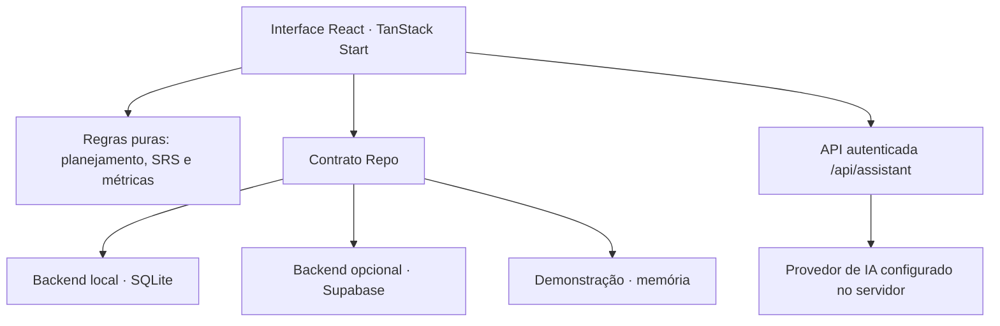

<div align="center">


# StudyMind AI

### Seu espaço para organizar, praticar e evoluir nos estudos.

Disciplinas, prazos, foco, revisões e materiais em uma experiência integrada, em português — com inteligência artificial quando você precisar.


[Recursos](#-uma-rotina-de-estudos-conectada) · [Começar](#-comece-em-poucos-passos) · [Arquitetura](#-por-dentro-do-projeto) · [Hospedagem](#-coloque-no-ar) · [Android](#-studymind-no-android)

</div>

---

## 🌱 Aprender com mais organização

O **StudyMind AI** reúne as etapas da rotina de estudos: entender o que precisa ser feito, reservar tempo, estudar com foco e revisar o aprendizado. Em vez de espalhar atividades, arquivos e anotações entre várias ferramentas, o estudante acompanha tudo em um único ambiente.

A aplicação tem interface responsiva, modos claro e escuro e preferências de aparência. Funciona com **servidor próprio e SQLite persistente por padrão**, sem depender de Supabase ou de um provedor de IA para cadastrar uma conta e salvar os estudos. Supabase é uma alternativa para autenticação, banco e armazenamento.

> **Planejamento é algoritmo; assistência é IA.** O planejador é determinístico e usa prazos, prioridades e disponibilidade. O tutor e a geração de conteúdo dependem de um provedor configurado no servidor. Sem configuração, o aplicativo informa a indisponibilidade e não simula respostas.

## ✨ Uma rotina de estudos conectada

| Etapa                     | O que você encontra                                                                                                                         |
| :------------------------ | :------------------------------------------------------------------------------------------------------------------------------------------ |
| **Organizar**             | Painel da rotina, disciplinas, atividades com prazo e prioridade, calendário e disponibilidade semanal.                                     |
| **Planejar**              | Distribuição de atividades em blocos de estudo, indicação do que não coube na agenda e planejamento adaptativo com evidências do histórico. |
| **Manter o foco**         | Pomodoro, pausas e registro de sessões associado aos estudos.                                                                               |
| **Revisar**               | Flashcards com repetição espaçada, em uma variação simplificada do SM-2, com avaliação de dificuldade.                                      |
| **Praticar**              | Banco fixo de exercícios por curso, questionários, simulados e histórico de respostas.                                                      |
| **Consultar materiais**   | Importação de TXT, Markdown, PDF, DOCX e PPTX, preservação do original e leitura do texto extraído.                                         |
| **Estudar com IA**        | Tutor com contexto de materiais, resumos, tópicos principais, conceitos, guias de revisão, flashcards e questões geradas.                   |
| **Acompanhar a evolução** | Metas, minutos estudados, sessões e indicadores de acerto por tópico.                                                                       |
| **Cuidar dos dados**      | Exportação e importação de estudos, arquivos privados e recuperação de conta conforme o backend escolhido.                                  |

### Materiais que viram prática

Importe um material, consulte seu conteúdo e, com IA configurada, transforme-o em resumo, guia, flashcards, questionário ou simulado. As ferramentas incluem questões de múltipla escolha, verdadeiro ou falso e discursivas; a correção discursiva usa o provedor de IA.

- **TXT e Markdown:** até 1 MB por arquivo.
- **PDF, DOCX e PPTX:** até 10 MB por arquivo.
- **Texto extraído:** até 200 mil caracteres por material.
- **PDF digitalizado:** OCR local em português e inglês, para até 20 páginas sem texto. O primeiro uso depende do download dos idiomas; a qualidade do reconhecimento varia com o documento.

### Quatro áreas de formação

O catálogo oferece **Informática para Internet**, **Agroecologia**, **Biotecnologia** e **Mecatrônica**, com sugestões de disciplinas e exercícios fixos relacionados a essas áreas. O curso é escolhido no onboarding e pode ser alterado nas configurações.

As sugestões ajudam a começar; **não representam uma matriz curricular oficial**.

## 🚀 Comece em poucos passos

**Requisitos:** Node.js **22.13 ou superior** e npm.

```bash
npm ci
npm run setup:check
npm run dev
```

Acesse **http://localhost:8080/cadastro**, crie sua conta e conclua o onboarding. No modo local, guarde o **código privado de recuperação** exibido no cadastro: ele permite redefinir a senha sem envio de e-mail.

O banco é criado automaticamente em `data/studymind.sqlite`. Os dados permanecem após recarregar a página ou reiniciar o servidor.

Para personalizar a configuração, copie o modelo de ambiente:

```bash
cp .env.example .env
```

O [arquivo de exemplo](./.env.example) já seleciona o backend local. Não é necessário configurar serviços externos para começar.

**Quer explorar sem uma conta?** Com o servidor rodando, abra **http://localhost:8080/demo/painel**. A demonstração usa dados em memória, separados do banco real, e perde as alterações ao recarregar.

## 🧭 Por dentro do projeto

O StudyMind combina uma interface React com rotas e servidor TanStack Start. As regras de negócio ficam separadas da interface, e o acesso aos dados passa por um contrato comum, o **Repo**.



### Tecnologias

| Camada                  | Tecnologias                                                           |
| :---------------------- | :-------------------------------------------------------------------- |
| Interface               | React 19, TypeScript, Tailwind CSS 4, Radix UI e Lucide               |
| Aplicação e rotas       | TanStack Start, TanStack Router, TanStack Query e Vite 8              |
| Servidor                | Node.js e Nitro                                                       |
| Persistência padrão     | SQLite local no servidor                                              |
| Backend opcional        | Supabase Auth, PostgreSQL com RLS e Storage privado                   |
| Inteligência artificial | AI SDK e provedor compatível com Chat Completions                     |
| Documentos              | PDF.js, Tesseract.js e extração de texto OOXML                        |
| Validação e qualidade   | Zod, Vitest, Testing Library, PGlite, Playwright, ESLint e TypeScript |
| Publicação independente | Docker Compose e Caddy com HTTPS                                      |
| Android                 | Aplicativo híbrido com WebView                                        |

### Mapa do código

```text
src/
├── components/
│   ├── app/               # Estrutura do app, tutorial e conteúdo Markdown
│   ├── sections/          # Telas de estudo, prática e conta
│   └── ui/                # Componentes de interface
├── lib/
│   ├── core/              # Regras puras: planner, SRS, métricas e validações
│   ├── repo/              # Contrato e adaptadores local, cloud e memória
│   ├── local/             # Autenticação, API e banco locais
│   ├── auth/              # Fluxos e integração de autenticação
│   └── ai/                # Integração de IA exclusiva do servidor
├── routes/                # Rotas públicas, autenticadas e APIs
└── test/                  # Testes de regras, componentes e integrações
android/                   # Cliente Android e instruções de build
e2e/                       # Fluxos de navegador com Playwright
supabase/migrations/       # Migrações SQL versionadas, incluindo SQLite
scripts/                   # Setup, diagnóstico, backup e autorização Gmail
docs/                      # Operação, avaliações e planejamento de entregas
```

### Decisões que sustentam a aplicação

- **Regras verificáveis:** planejamento, repetição espaçada e métricas são funções puras em [core](./src/lib/core), com testes em [core.test.ts](./src/test/core.test.ts). Mesmas entradas produzem o mesmo planejamento.
- **Isolamento de dados:** toda operação de dados da interface usa o [Repo](./src/lib/repo). Contas reais usam SQLite ou Supabase; a demonstração usa memória.
- **Sessões idempotentes:** cada sessão de estudo recebe um `client_id` no cliente e é registrada por upsert em `(user_id, client_id)`.
- **IA no servidor:** as chamadas ficam em [ai](./src/lib/ai), através de `/api/assistant`, com verificação de Bearer e cotas de uso.
- **Evolução do banco:** alterações de schema ficam em [migrações versionadas](./supabase/migrations), sem reescrever histórico aplicado ou apagar dados de produção.

## 🔐 Escolha onde seus dados ficam

|                | Local — padrão             | Supabase — opcional                           | Demonstração                           |
| :------------- | :------------------------- | :-------------------------------------------- | :------------------------------------- |
| Persistência   | SQLite no servidor         | PostgreSQL e Storage                          | Memória                                |
| Acesso         | E-mail e senha próprios    | Supabase Auth; Google opcional                | Sem conta real                         |
| Recuperação    | Código privado             | Fluxo de recuperação por e-mail               | Não se aplica                          |
| Infraestrutura | Node com disco persistente | Projeto Supabase e servidor da aplicação      | A mesma aplicação, com Repo em memória |
| Indicação      | Hospedagem independente    | Instalações que preferem serviços gerenciados | Explorar a interface                   |

### Backend local

Sem configuração Supabase, o aplicativo seleciona SQLite. Para fixar essa escolha, use:

```dotenv
VITE_BACKEND=local
LOCAL_DATA_DIR=./data
```

A autenticação local usa cookie **HttpOnly**, senhas com **scrypt** e Bearer curto para acesso à API de IA. A recuperação de senha invalida as sessões e substitui o código de recuperação. Não há envio de e-mail nesse fluxo; o login Google fica oculto no modo local.

Perfil, atividades, sessões, cartões, metas, materiais, conversas, simulados e arquivos privados são persistidos no servidor e separados por usuário. A pasta de dados deve permanecer privada e fora do Git.

Cliente e servidor precisam usar o mesmo backend. A aplicação não troca de banco automaticamente quando ocorre uma falha de rede. Alterações em variáveis `VITE_*` exigem novo build em produção.

<details>
<summary><strong>Configurar Supabase</strong></summary>

1. Crie um projeto no [painel Supabase](https://supabase.com/dashboard).
2. No ambiente, defina `VITE_BACKEND=supabase`, `VITE_SUPABASE_URL` e `VITE_SUPABASE_PUBLISHABLE_KEY`. Use a chave **publishable** ou anon pública. Configure também `SUPABASE_URL` e `SUPABASE_PUBLISHABLE_KEY` com os mesmos valores para o servidor.
3. Copie a conexão PostgreSQL do painel **Connect** para `DATABASE_URL`. Se a rede não tiver IPv6, use o pooler de sessão. Execute `npm run db:setup` para aplicar tabelas, RLS, Storage privado e demais migrações.
4. Habilite cadastro e e-mail/senha em **Authentication**. Configure a Site URL e autorize as rotas `/auth/callback` e `/reset-password` na origem usada, incluindo `http://localhost:8080` em desenvolvimento.
5. Configure [SMTP próprio](https://supabase.com/docs/guides/auth/auth-smtp) para confirmação e recuperação por e-mail em produção.
6. Reinicie o servidor de desenvolvimento ou gere novo build na hospedagem.

Com confirmação habilitada, o cadastro envia o link de confirmação; o callback valida a sessão e encaminha ao onboarding. Se Auth entregar uma sessão imediatamente, o cadastro abre o onboarding diretamente.

**Google opcional:** configure o provedor Google no Supabase, autorize o callback do Supabase no Google Cloud e só então defina `VITE_GOOGLE_AUTH_ENABLED=true`.

O setup PostgreSQL registra checksums, aplica as migrações em transação e pode ser repetido. Ele recusa tabelas StudyMind preexistentes sem seu histórico de migrações. O [histórico legado Drizzle](./drizzle) não é a fonte para uma instalação nova.

**Supabase local:** com Docker e CLI atual (v2.108+ ou v3), execute:

```bash
npx supabase start
npx supabase status
```

Use a URL e as chaves informadas pela CLI. Nesse caminho, **não execute `db:setup`**, pois a CLI gerencia o histórico. O servidor de e-mails de teste fica em http://localhost:54324.

Contas SQLite não são transferidas automaticamente para Supabase. A transferência de autenticação e armazenamento exige um procedimento próprio.

</details>

## 🤖 Assistência com IA, do seu jeito

Escolha um provedor compatível com **Chat Completions** e configure no ambiente privado do servidor:

```dotenv
AI_BASE_URL=https://seu-provedor.example/v1
AI_MODEL=identificador-do-modelo
AI_API_KEY=sua-chave-privada
AI_DAILY_REQUEST_LIMIT=20
AI_MONTHLY_REQUEST_LIMIT=200
```

A URL e o modelo acima são exemplos: substitua pelos valores reais do provedor. As cotas devem ser inteiros positivos, com limite mensal maior ou igual ao diário. No backend local, 20 e 200 são os padrões.

No modo Supabase, configure também `SUPABASE_SERVICE_ROLE_KEY` para as cotas no servidor. Essa chave administrativa não é necessária para cadastro/login e nunca deve ser exposta ao navegador.

O assistente permite conversar com contexto de materiais e manter histórico. As ferramentas geram conteúdo de revisão e atividades a partir do material fornecido. **Revise as respostas geradas antes de usá-las como referência.**

`GET /api/assistant` informa o estado da configuração; não valida saldo ou disponibilidade do modelo. Organização, planejamento, Pomodoro, flashcards manuais e exercícios fixos continuam disponíveis sem IA.

> Nunca coloque chaves de IA, service-role ou credenciais Gmail em variáveis `VITE_*`: elas são públicas e entram no build do cliente.

## ☁️ Coloque no ar

### Servidor próprio com Docker e HTTPS

O [Docker Compose](./compose.yaml) inclui servidor Node, SQLite em volume persistente e Caddy para HTTPS automático. Aponte o DNS do domínio para o servidor, libere as portas **80 e 443** e execute:

```bash
STUDYMIND_DOMAIN=estudos.seudominio.com docker compose up -d --build
```

Depois, acesse `https://estudos.seudominio.com/cadastro`.

O volume `study-data` preserva contas, arquivos e sessões ao recriar o contêiner. **Não use `docker compose down -v` para uma parada comum:** a opção `-v` apaga os volumes. Essa instalação cria um banco novo; não importa o banco de desenvolvimento automaticamente.

O contêiner não copia o ambiente privado local. Para habilitar IA ou feedback, configure as variáveis de servidor no serviço `app`.

### Servidor Node

```bash
npm run check
npm start
```

O comando `check` inclui o build, que gera `.output/server/index.mjs`. Também é possível gerar apenas com `npm run build`.

Para SQLite, use **disco persistente e uma única instância da aplicação** compartilhando o banco. Se o proxy usar uma origem interna diferente da pública, configure `APP_ORIGIN` com a origem HTTPS pública. Não exponha a pasta de dados como conteúdo estático.

### Vercel e outros ambientes sem disco persistente

Na Vercel, use **Supabase**. O build recusa o backend local nesse ambiente: SQLite em disco temporário, inclusive `/tmp`, não mantém as contas de forma persistente.

1. Configure `VITE_BACKEND=supabase`, as variáveis públicas Supabase e suas correspondentes de servidor no ambiente da hospedagem.
2. Aplique `npm run db:setup` em ambiente administrativo com `DATABASE_URL` privado.
3. Configure no Supabase a Site URL, os redirects de confirmação/recuperação no domínio publicado e SMTP.
4. Faça novo deploy e valide cadastro, confirmação, login e gravação de dados.

As variáveis opcionais de IA devem ser configuradas separadamente na hospedagem. O ambiente local não configura o deploy. Outros destinos dependem do [adaptador de servidor compatível com TanStack Start](https://tanstack.com/start/latest/docs/framework/react/guide/hosting); hospedagem apenas estática não executa as APIs.

## 📱 StudyMind no Android

**[📥 Baixar APK 1.0.2 para Android](./StudyMind-1.0.2-debug.apk)** — versão de desenvolvimento com correção das faixas brancas nas barras superior e inferior, incluindo Android 15. No GitHub, abra o arquivo e use **Download raw file** para baixar. Instale esta versão para receber a correção nativa; atualizar apenas o site não altera o APK 1.0.1 já instalado.

O projeto inclui um **cliente Android híbrido com WebView**, compatível com Android 8 ou superior. Ele abre a instalação web em uma janela de aplicativo e usa as mesmas contas e dados do servidor.

O APK depende de um **backend HTTPS acessível pelo aparelho**. Ele não executa Node, não mantém um banco independente no telefone e não oferece a interface completa offline.

Você pode gerar o APK pelo workflow **Android APK** no GitHub Actions ou pelo SDK local. Endereço do servidor, requisitos, comandos e limitações estão no [guia Android](./android/README.md).

O workflow gera um APK de desenvolvimento; publicação na Play Store requer assinatura release e validação própria. Testes de navegador móvel não substituem testes no WebView de um aparelho.

## 🧪 Desenvolvimento e qualidade

| Comando                     | Finalidade                                         |
| :-------------------------- | :------------------------------------------------- |
| `npm run dev`               | Iniciar o servidor de desenvolvimento              |
| `npm run setup:check`       | Diagnosticar a configuração sem imprimir segredos  |
| `npm run db:setup`          | Inicializar SQLite ou aplicar migrações PostgreSQL |
| `npm run lint`              | Verificar o código com ESLint                      |
| `npm run typecheck`         | Validar tipos da aplicação e dos testes E2E        |
| `npm test`                  | Executar testes com Vitest                         |
| `npm run test:watch`        | Executar testes em modo de acompanhamento          |
| `npm run build`             | Gerar a aplicação para produção                    |
| `npm run check`             | Executar lint, tipos, testes e build               |
| `npm run test:e2e`          | Validar fluxos de navegador com Playwright         |
| `npm start`                 | Iniciar o build de produção                        |
| `npm run backup:local -- …` | Criar ou restaurar snapshots administrativos       |

Para preparar os testes de navegador:

```bash
npx playwright install chromium
npm run test:e2e
```

Os E2E usam build local, contas de teste e um banco separado. Se seu ambiente estiver em Supabase, gere antes o build com `VITE_BACKEND=local`. Os cenários cobrem Chromium desktop e emulação de celular.

O [workflow de qualidade](./.github/workflows/quality.yml) executa lint, tipagem, testes, build e E2E, com relatórios em caso de falha. A suíte inclui regras de negócio, autenticação, isolamento, documentos, backup e integrações. Os testes PostgreSQL usam PGlite com schemas mínimos de Auth/Storage; envio real de e-mail, OAuth e serviços externos precisam de validação no ambiente publicado.

## 💾 Backup e operação

**Backup pela interface:** em Configurações, exporte um JSON v2 com perfil, dados de estudo, conversas, simulados e arquivos originais. O limite total é **64 MB**. A importação valida estrutura, referências e hashes, cria novos IDs e adiciona os dados à conta atual. **Reimportar cria cópias.** Backups v1 continuam aceitos; contas, senhas e sessões de acesso não fazem parte do JSON.

**Snapshot administrativo local:** inclui o backend SQLite completo, com contas, hashes de senhas, sessões e binários. Guarde-o como arquivo privado.

```bash
npm run backup:local -- create ./backups/studymind.sqlite
npm run backup:local -- restore ./backups/studymind.sqlite ./data-restaurada
```

A criação usa uma cópia consistente do SQLite e gera checksum. A restauração verifica integridade e exige uma pasta de destino que ainda não exista, preservando a instalação atual.

**Saúde e métricas:** `/api/health` verifica a aplicação e, no modo local, a consulta ao SQLite. No modo Supabase, identifica o serviço externo como não sondado. `/api/monitoring` exige Bearer com `MONITORING_TOKEN`; `MONITORING_LOG_DIR` habilita logs JSONL com rotação. Os contadores são por processo.

Consulte o [guia de operação e recuperação](./docs/operacao-e-recuperacao.md) para detalhes de restauração, monitoramento e limites transacionais do Storage no Supabase.

<details>
<summary><strong>💬 Configurar o envio de feedback</strong></summary>

A seção **Conta → Feedback** recebe nome, Gmail de contato, tipo e mensagem. A API autenticada persiste o texto antes do envio e só confirma sucesso quando o Gmail aceita a mensagem. Se houver falha, informa o erro e mantém o registro. A demonstração não envia feedback real.

O destino é fixo em `system.ifsc@gmail.com`. O endereço informado pelo usuário entra como `Reply-To`; o remetente é a conta autorizada do aplicativo. Os registros da tabela `app_feedback` ficam separados dos backups de estudos e entram nos snapshots completos do SQLite.

**Opção SMTP:** ative a verificação em duas etapas na conta remetente, crie uma [senha de app](https://myaccount.google.com/apppasswords) e configure `GMAIL_SENDER` e `GMAIL_APP_PASSWORD` no servidor. Não use a senha normal da conta. O envio usa TLS em `smtp.gmail.com:465`.

**Alternativa OAuth:** habilite Gmail API e consentimento no Google Cloud, crie um cliente do tipo Aplicativo para computador e mantenha o JSON de credenciais fora do repositório. Execute:

```bash
npm run feedback:authorize -- /caminho/privado/client_secret.json
```

Autorize a conta remetente com o escopo `gmail.send`. O script salva as credenciais no ambiente privado local sem exibi-las e não envia mensagens. Na hospedagem, configure `GMAIL_CLIENT_ID`, `GMAIL_CLIENT_SECRET`, `GMAIL_REFRESH_TOKEN` e `GMAIL_SENDER`, depois reinicie o serviço.

SMTP tem prioridade quando a senha de app está configurada. No OAuth externo em modo Testing, tokens com esse escopo expiram em sete dias; ajuste o status de publicação para uso contínuo. Consulte a [documentação OAuth do Google](https://developers.google.com/identity/protocols/oauth2/web-server).

</details>

## 📌 Limites atuais

- O Pomodoro permanece no navegador até a conclusão; não é um serviço de execução em segundo plano.
- O cache do navegador cobre assets públicos, sem oferecer operação completa offline ou armazenar páginas autenticadas e APIs.
- Preferências de aparência ficam no navegador. Sons e vibração dependem do dispositivo; notificações push ainda não estão disponíveis.
- OCR e geração de conteúdo dependem, respectivamente, da legibilidade do documento e da configuração do provedor de IA.
- O cliente Android tem limitações para OAuth, retorno por links externos e downloads `blob:`, detalhadas no seu guia.
- Mudar de SQLite para Supabase não transfere contas automaticamente; o backup de estudos não substitui a migração de autenticação.

## 📚 Explore a documentação

| Documento                                                         | Conteúdo                                                   |
| :---------------------------------------------------------------- | :--------------------------------------------------------- |
| [Operação e recuperação](./docs/operacao-e-recuperacao.md)        | Backup, restauração, monitoramento e validação operacional |
| [Aplicativo Android](./android/README.md)                         | Geração do APK, servidor HTTPS e testes em dispositivo     |
| [Modelo de ambiente](./.env.example)                              | Variáveis públicas e privadas disponíveis                  |
| [Migrações SQL](./supabase/migrations)                            | Evolução versionada dos bancos                             |
| [Roadmap de entregas](./docs/roadmap-delivery.md)                 | Planejamento e registro de entregas                        |
| [Saúde do projeto](./docs/project-health.md)                      | Avaliação técnica registrada                               |
| [Comparativo de funcionalidades](./docs/studyfetch-comparison.md) | Análise de recursos frente ao StudyFetch                   |

---

<div align="center">

**StudyMind AI** · Organize sua rotina. Pratique com intenção. Acompanhe sua evolução.

</div>
